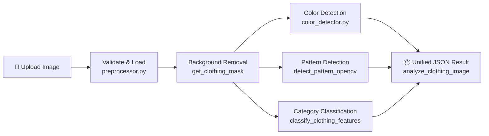
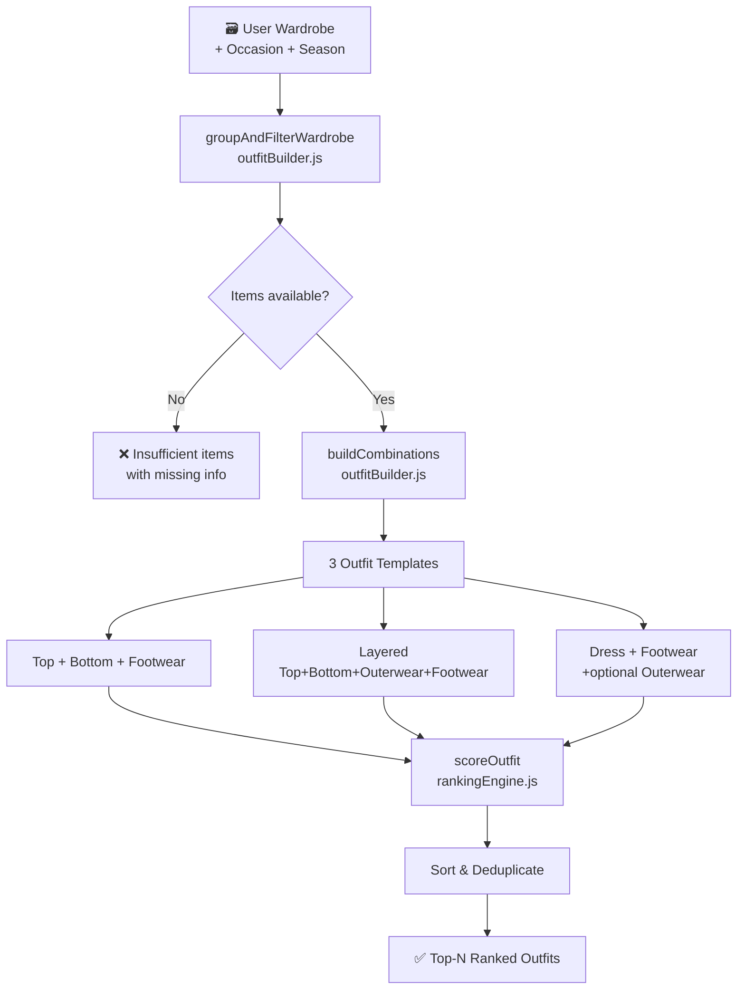
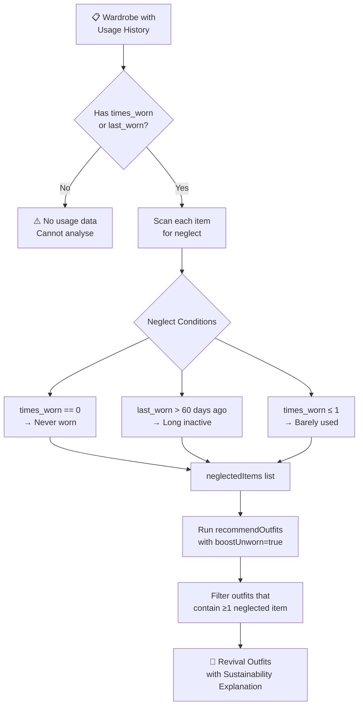

# 🧠 AI Service — How It Works

The `ai_service` is split into two engines:
1. **Vision** (Python / OpenCV) — Analyses clothing images
2. **Recommender** (Node.js) — Suggests outfits from your wardrobe

---

## 1️⃣ Cloth Image Analysis (`vision/`)

When you upload a clothing photo, it passes through a **4-step pipeline** inside [`classifier.py`](file:///d:/Sneha/AOSC%20Work/Wardrobe_project/Wardrobe/ai_service/vision/classifier.py):



### Step-by-step breakdown

#### Step 1 — Background Removal (`get_clothing_mask`)
- Samples the **4 corners** of the image to estimate background color
- Computes pixel-by-pixel Euclidean distance from that background color
- If >70% of the image looks like background (textured backgrounds like wooden floors), falls back to **OpenCV GrabCut** algorithm
- Returns a binary mask isolating only the clothing pixels

#### Step 2 — Color Detection (`color_detector.py → extract_dominant_colors`)
- Resizes image to 150×150 for speed
- Applies **K-Means clustering** (k=4) on foreground pixels only
- Maps cluster centers to the 21-color fashion palette using **weighted RGB distance** (human eye sensitivity: R×0.3, G×0.59, B×0.11)
- Returns: `dominant` color + `secondary` color (if ≥12% of pixels) + their hex codes

| Output Field | Example |
|---|---|
| `dominant` | `"Navy Blue"` |
| `dominant_hex` | `"#18436A"` |
| `secondary` | `"White"` |
| `secondary_hex` | `"#F5F5F5"` |

#### Step 3 — Pattern Detection (`detect_pattern_opencv`)
Uses **OpenCV gradient analysis**, not a neural network — so it works offline with no model download:

| Signal | Pattern Detected |
|---|---|
| Low pixel variance (<220) | **Plain** |
| High single-axis Sobel gradient | **Striped** |
| High center variance + low side variance | **Printed** (graphic tee) |
| Many edge contours + floral colors | **Floral** |
| Grid peaks in both X and Y axes | **Checked / Plaid** |

#### Step 4 — Category Classification (`classify_clothing_features`)
Classifies across **14 categories** using geometric analysis of the clothing mask:

```
Footwear  → aspect ratio (height/width) < 0.70
Jeans     → tall + leg-split detected + blue dominant color
Trousers  → tall + leg-split + non-blue color
Dress     → tall + no leg-split + flared silhouette
Hoodie    → medium ratio + hood apex detected
Jacket    → grey/black + lapel texture variance > 600
Shirt     → checked pattern OR white collar with placket edges
T-shirt   → medium ratio, no hood/lapel/collar features
Shorts    → short + leg-split present
Skirt     → short + no leg-split
```

> **CLIP Fallback**: If PyTorch/HuggingFace is available, the model lazily loads `openai/clip-vit-base-patch32` for zero-shot classification as an optional upgrade path.

#### Final Output — `analyze_clothing_image()`
```json
{
  "item_id": "item_a1b2c3d4",
  "processing_status": "success",
  "category": "Jeans",
  "category_group": "bottom",
  "confidence": 0.90,
  "alternative_predictions": [{"category": "Trousers", "confidence": 0.06}],
  "colour": {"dominant": "Navy Blue", "dominant_hex": "#18436A", "secondary": null},
  "pattern": "Plain",
  "pattern_confidence": 0.90,
  "recommended_seasons": ["Summer", "Winter", "Monsoon", "Spring"],
  "recommended_occasions": ["Casual outing", "College", "Travel", "Party"]
}
```

---

## 2️⃣ Smart Outfit Recommendation (`recommender/`)

Takes your **entire wardrobe** (array of items) + context (occasion, season) and returns ranked outfit combinations.



### Scoring System (max 100 points)

| Component | Max Points | Source |
|---|---|---|
| **Color Harmony** | 40 pts | `colorRules.js` |
| **Occasion Fit** | 30 pts | `rankingEngine.js` |
| **Season Fit** | 30 pts | `rankingEngine.js` |
| **Unworn Clothing Boost** | +20 pts | `rankingEngine.js` |
| **Cold Season Outerwear Bonus** | +5 pts | `rankingEngine.js` |
| **Color Clash Penalty** | Capped at 45 | `rankingEngine.js` |

### Color Harmony Engine (`colorRules.js`)
Implements fashion color theory rules — no ML, pure logic:

- **Neutral Anchors**: White, Black, Grey, Beige, Navy — pair with anything (score: 90-95)
- **Monochromatic**: Same color family (Navy + Sky Blue → score: 88)
- **Harmony Pairs**: Documented fashion-safe pairs e.g. Navy+White, Grey+Burgundy (score: 85)
- **Clash Detection**: 5 known clash pairs e.g. Red+Green, Brown+Black, Navy+Black (score: 35, outfit capped at 45)

---

## 3️⃣ Sustainable Unused Clothing Revival (`recommendUnusedItemOutfits`)

Identifies **neglected clothes** and builds outfits **centered around them**, encouraging re-use instead of buying new.



### Unworn Boost Points (inside `rankingEngine.js`)
| Condition | Bonus |
|---|---|
| Never worn (`times_worn == 0`) | +10 pts |
| Worn ≤ 2 times | +5 pts |
| Not worn in > 60 days | +6 pts |
| Maximum cap | 20 pts |

### Example Explanation Output
> *"Sustainable pick: Helps you re-wear forgotten clothes (Blue Shirt - Never worn, Black Boots - Unworn for 73 days). Well-suited for Office wear in Winter. Includes warm outerwear layering ideal for cold weather."*

---

## Architecture Overview

```
ai_service/
├── vision/              ← Python (OpenCV, PIL, NumPy)
│   ├── preprocessor.py  ← Image loading & validation
│   ├── color_detector.py← K-Means color clustering
│   └── classifier.py    ← Category, pattern detection
│
├── recommender/         ← Node.js (pure logic, no ML)
│   ├── outfitBuilder.js ← Groups wardrobe, builds combinations
│   ├── colorRules.js    ← Fashion color harmony engine
│   ├── rankingEngine.js ← Multi-factor scoring + explanations
│   └── recommender.js   ← Main entry: recommendOutfits + unusedItemOutfits
│
└── api/                 ← FastAPI (Python)
    ├── app.py           ← REST endpoints
    └── schemas.py       ← Request/Response models
```

> [!NOTE]
> The entire system works **offline** — no internet or paid AI API calls required. Vision uses OpenCV; Recommender uses rule-based logic. CLIP is an optional enhancement if PyTorch is installed.

> [!TIP]
> The `boostUnworn: true` flag (default ON) ensures that neglected items naturally surface in regular outfit recommendations too — not just in the dedicated revival flow.
